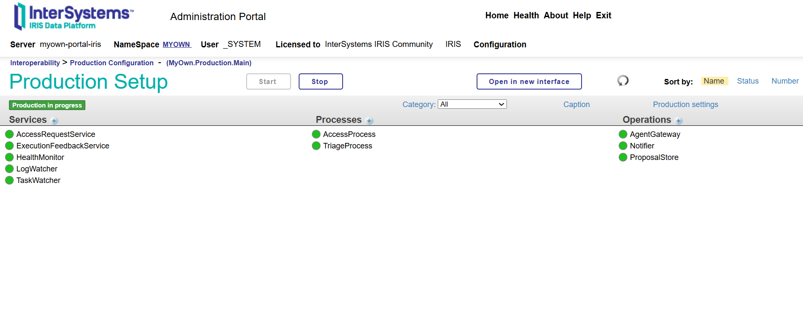
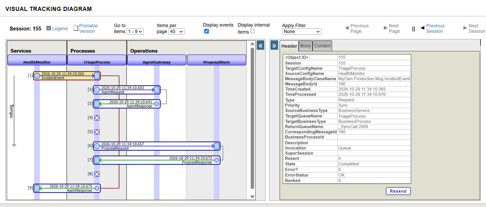

# MyOwn Portal — AI Agents in Interoperability Workflows

MyOwn Portal is an administration portal for InterSystems IRIS and IRIS for Health. This entry adds an interoperability production in which an AI agent triages incidents and access requests: it reads the instance, decides and explains, and proposes a change, while a person confirms it.

- **What it does:** health anomalies, failing tasks, log alerts and role requests become events in an IRIS production; the agent returns a decision (ignore, notify, escalate, propose a task action, approve or deny a role) with a rationale, evidence and a confidence value.
- **How it fits the theme:** the agent is a step inside a real interoperability workflow (Business Services → Business Processes → Business Operations), built on IRIS AI Hub (`%AI.Agent`, ToolSets, policies) in build `2026.3.0AI.154.0`.
- **What is technically interesting:** the agent never writes. Every decision passes a schema Validator and a deterministic Gate; a human confirms with their own credentials; the change is revalidated, executed and read back. Read-only tools are enforced by an allow-list policy, every AI call lands in a token/cost/latency ledger, and when the model is slow, wrong or unavailable the deterministic Rules engine decides instead and the screen says why.

## Links

- Online demo: http://163.176.71.47:52774/myown/index.html (user `demo`, password `demo`; replay mode on a live IRIS 2026.3.0AI.154.0 ARM64 AI Hub instance, see [Demo mode](#demo-mode))
- Video: **[TODO: URL]**
- Article on the Developer Community: **[TODO: URL]**
- API docs (DPI-I-767): http://163.176.71.47:52774/myown/api/docs (user `demo`, password `demo`)
- Embedded Python bug found and reported: [python-bugreports #25](https://github.com/intersystems-community/python-bugreports/issues/25)
- AI Hub bugs found and reported: [ai-hub-eap-bugreports #5](https://github.com/intersystems-community/ai-hub-eap-bugreports/issues/5), [#6](https://github.com/intersystems-community/ai-hub-eap-bugreports/issues/6)

## Try it in a minute

Run three scenarios on the hosted demo through the REST API, as the `demo` account (Windows PowerShell 5.1 or later):

```powershell
.\scripts\Try-Demo.ps1 -BaseUrl http://163.176.71.47:52774
```

The same calls with `curl.exe` (from PowerShell; in `cmd` write the body as `"{\"scenario\":\"S1\"}"`):

```powershell
curl.exe -s -u demo:demo -H "Content-Type: application/json" -d '{\"scenario\":\"S1\"}' http://163.176.71.47:52774/myown/api/agent/simulate
curl.exe -s -u demo:demo http://163.176.71.47:52774/myown/api/agent/decisions
curl.exe -s -u demo:demo http://163.176.71.47:52774/myown/api/agent/traces/<traceId from the first call>
```

Output of a real run on 2026-10-29 (proposal numbers depend on what the demo already holds):

```
Server http://163.176.71.47:52774, AI mode replay, engine preference auto, model gemini-3.5-flash-lite.

Scenario Action               Engine Tokens ToolCalls Proposal
-------- ------               ------ ------ --------- --------
S1       escalate             aihub     587         0 -
S2       propose_task_suspend aihub    1325         0 #2 task.suspend (pending)
S5       approve              aihub     571         0 #3 role.assign (pending)

Proposals stay pending until a human confirms or rejects them in Agents > Approvals.
```

The demo allows 6 scenarios per minute per address; beyond that the script reports HTTP 429.

## Why this design

- **The agent only decides.** It has read-only tools and no write path. A state change exists only as a proposal that expires.
- **Validator.** The model output must be a single JSON object matching schema v1: strict types, an allow-list of fields and actions, bounded text, and targets taken from the candidate list the server supplied.
- **Gate.** Kill switch, read-only mode, prohibited targets (for example the `%All` role), downgrade of high-risk decisions to escalation, one open proposal per target and action, budget and cooldown.
- **Human confirmation revalidates everything:** state, expiry, separation of duties (a requester cannot confirm their own request), prohibited targets, the target fingerprint (`TARGET_CHANGED`) and the confirming user's live permission. The change runs with that user's credentials and is read back.
- **Untrusted data stays data.** Log lines, task errors and justifications reach the model only inside delimiters, sanitized and with the delimiter characters escaped.
- **Always a working system.** Without AI Hub, without a key, with the kill switch on, over budget, or when the provider fails, the Rules engine decides. The reason is recorded and shown as a badge such as `Rules (provider_timeout)`.

## Architecture

```
HealthMonitor · TaskWatcher · LogWatcher · AccessRequestService      Business Services
        │  event (context with untrusted data delimited)
        ▼
TriageProcess · AccessProcess                                       Business Processes
   1. decide (AgentGateway)  2. Gate  3. proposal (ProposalStore)
        │
        ▼
AgentGateway ─┬─ AI Hub engine: %AI.Agent + read-only ToolSet,      Business Operations
              │  allow-list policy, audit policy, own deadline
              └─ Rules engine (fallback, always available)
        │  Validator → Gate → proposal → human confirmation → read-back → audit
        ▼
REST /myown/api/agent/*  →  React UI: Decisions, Approvals, Access, Production, Guardrails, Settings
```

The production `MyOwn.Production.Main` has ten items:

| Layer | Name | Class | Role |
|---|---|---|---|
| Service | `HealthMonitor` | `MyOwn.Production.Service.HealthMonitor` | Every 60 s reads the instance health report and sends an incident to `TriageProcess` when it finds anomalies; also the entry point of the demonstration scenarios |
| Service | `TaskWatcher` | `MyOwn.Production.Service.TaskWatcher` | Through the adapter `TaskHistoryInbound`, every 120 s, reports tasks of `MYOWN` with 3 or more consecutive failures, or suspended with a last run that succeeded, to `TriageProcess` |
| Service | `LogWatcher` | `MyOwn.Production.Service.LogWatcher` | Through the adapter `LogEntriesInbound`, every 120 s, sends up to 10 log entries of severity 2 or higher to `TriageProcess` |
| Service | `AccessRequestService` | `MyOwn.Production.Service.AccessRequest` | Receives access requests filed in the portal and sends them to `AccessProcess` |
| Service | `ExecutionFeedbackService` | `MyOwn.Production.Service.ExecutionFeedback` | Receives the result (executed or failed) of a confirmed proposal and sends it to `Notifier` |
| Process | `TriageProcess` | `MyOwn.Production.Process.Triage` | Routes the incident with the rule `MyOwn.Production.Rule.Routing` (or drops it), then decide (`AgentGateway`) → Gate → proposal (`ProposalStore`); notifies `Notifier` when the AI budget is exhausted |
| Process | `AccessProcess` | `MyOwn.Production.Process.Access` | The same three steps for access requests |
| Operation | `AgentGateway` | `MyOwn.Production.Operation.AgentGateway` | Step 1: chooses the engine (AI Hub or Rules), validates the decision and writes the ledger |
| Operation | `ProposalStore` | `MyOwn.Production.Operation.ProposalStore` | Step 3: re-checks the Gate on the final decision and creates the proposal (before/after diff, expiry) |
| Operation | `Notifier` | `MyOwn.Production.Operation.Notifier` | Stores execution feedback and budget notifications |



*The production `MyOwn.Production.Main` running, with all ten items active (Interoperability > Production Configuration).*



*The Visual Trace of one message: from the business service `HealthMonitor` through `TriageProcess` to the agent operation `AgentGateway`, then `ProposalStore`, and the response back to the service.*

The production runs inside IRIS and is viewed in the native Management Portal (Interoperability > Configure > Production); the hosted demo shows only the safe areas of MyOwn Portal.

Each event enters the production as a message sent by a Business Service, so its path through the process and the operations can be followed in the Visual Trace of the Message Viewer; the Gate runs inside the process and writes an Event Log entry with the same trace id. `AgentGateway` is where the AI Hub agent is called: it calls `MyOwn.Agent.Service.Agent.Decide`, which runs `MyOwn.AIHub.Engine` when it is installed and ready and the kill switch, the engine preference and the budget allow it; otherwise, or when the AI call fails or its reply fails the Validator, the Rules engine decides.

The AI Hub engine (`aihub/src`, part of the one IPM module `myown-portal`) is compiled only where the `%AI` package exists; elsewhere the portal runs on Rules.

## Technologies used

**Embedded Python** (`[ Language = python ]` methods, standard library only), called on every health report: the Overview screen, the `MyOwn Portal health snapshot` task and the `HealthMonitor` Business Service of the production all go through `MyOwn.Service.HealthAnalysis.GetReport`.

| Method | File | What it does |
|---|---|---|
| `AnalyzeWithPython` | `src/objectscript/MyOwn/Service/HealthAnalysis.cls:49` | Weighted health score 0–100 from five normalized risks (disk, database, locks, alerts, processes), status Healthy / Attention / Critical, and the main risk factor |
| `DetectAnomaliesWithPython` | `src/objectscript/MyOwn/Service/HealthAnalysis.cls:176` | z-score of each current metric against its own history (at least 5 snapshots); above 2 is a warning, above 3 critical. These anomalies are what the `HealthMonitor` sends to the agent |
| `GetDiskUsage` | `src/objectscript/MyOwn/Service/System.cls:62` | Disk total, free and used percent of the data directory (`shutil.disk_usage`) |
| `GetPhysicalMemoryKB` | `src/objectscript/MyOwn/Service/System.cls:75` | Physical memory, on Linux containers and on Windows |

**Vector Search.** `MyOwn.HealthPattern` (`src/objectscript/MyOwn/HealthPattern.cls:14`) stores six known health patterns (healthy, disk pressure, database capacity, lock contention, active alerts, process pressure; written by the installer, `Installer.cls:187-197`), each as a `%Vector(DOUBLE, 6)` of the same normalized risks plus a healthy reserve, with a recommendation. `GetReport` turns the current metrics into the same six-dimension vector and picks the closest pattern with `VECTOR_COSINE(MetricVector, TO_VECTOR(?, DOUBLE))` (`HealthAnalysis.cls:87`). The match and its similarity appear on the Overview and are part of the health context the agent receives. It is a small, explainable nearest-pattern lookup, not a document or embedding index.

**Custom inbound adapters.** The `TaskWatcher` and `LogWatcher` Business Services of the production use the portal's own adapters, both derived from `Ens.InboundAdapter` and polled every `CallInterval` (120 s). The scan lives in each adapter's `OnTask`, and the service only turns what it receives into an `IncidentEvent`. A failed query is written to the Event Log and retried at the next interval; the service keeps running.

| Adapter | File | What it hands the service | Settings (production) |
|---|---|---|---|
| `TaskHistoryInbound` | `src/objectscript/MyOwn/Production/Adapter/TaskHistoryInbound.cls` | One `TaskState` per task of the namespace that failed `FailureThreshold` times in a row (a run fails when its history `Status` is not 1), or that is suspended although its newest run succeeded | `TaskNamespace` (MYOWN), `HistoryRows` (200 newest history rows), `FailureThreshold` (3) |
| `LogEntriesInbound` | `src/objectscript/MyOwn/Production/Adapter/LogEntriesInbound.cls` | One `LogBatch` with the newest sanitized log entries of at least `MinSeverity`, when there is any | `MinSeverity` (2), `MaxEntries` (10) |

**Docker.** `Dockerfile` builds on the build 154 image (`ARG IMAGE`), installs IPM, enables interoperability on namespace `MYOWN`, loads both modules (`docker/iris.script`) and refuses an image whose installation did not finish. `compose.yaml` publishes the web port 52774 and keeps data in a named volume; `compose.aihub.yaml` adds the AI Hub settings.

**IPM module.** One module, `myown-portal` (`module.xml`). `MyOwn.Bootstrap` (in `preload/`, compiled first) enables interoperability on the namespace before the Ens-based classes compile. The module installs the `MyOwn` package and copies the built React UI from `web/` to the `/myown` web application. `MyOwn.Installer.LoadAIHub` compiles the AI Hub engine from `aihub/src` (engine, read-only tools and ToolSet, policies, replay fixtures) only where `%AI` exists. `MyOwn.Installer.Setup` seeds the health patterns and agent defaults, creates the `MyOwn.*` resources, roles and the `/myown/api` REST application, registers the agent audit events, schedules the health snapshot and agent retention tasks, grants SQL read access to the portal schemas and sets the agent production to start automatically. The test classes are not installed from the registry: `MyOwn.AIHub.Test` comes only in developer mode (`-dev`), and `MyOwn.Test` (`Scope="test"`) is loaded by the Docker build itself (`docker/iris.script`), because the test scripts need both. The registry currently has `myown-portal` 1.0.3; 1.1.0 is not published yet (see [docs/PUBLISH-CHECKLIST.md](docs/PUBLISH-CHECKLIST.md)).

## Ideas Portal

Two ideas from the InterSystems Ideas Portal are implemented in this repository:

| Idea | Implemented in | Where |
|---|---|---|
| [DPI-I-767 "Automatically Expose Interactive API Documentation"](https://ideas.intersystems.com/ideas/DPI-I-767) | this entry | `MyOwn.REST.Docs`: `/openapi.json` and an interactive `/docs` for any `%CSP.REST` class (see [API docs](#api-docs)) |
| [DPI-I-512 "add AI to Instance Monitor to prevent major incident"](https://ideas.intersystems.com/ideas/DPI-I-512) | MyOwn Portal, for the earlier *Build Your Own Management Portal* contest, and kept here | the AI Instance Monitor on the Overview page: health snapshots and Embedded Python anomaly detection against the instance's own history (`MyOwn.Service.HealthAnalysis`, see [docs/REFERENCE.md](docs/REFERENCE.md)). Its anomalies are now also what the `HealthMonitor` service sends to the agent |

## API docs

Try it live: http://163.176.71.47:52774/myown/api/docs (user `demo`, password `demo`). It lists 56 operations; GET operations can be tried in the page.

The portal API documents itself: `GET /myown/api/docs` is an interactive page and `GET /myown/api/openapi.json` the OpenAPI 3.0 document, both behind the same sign-in as the rest of the API. This answers what the community still asks for in the Ideas Portal idea [DPI-I-767 "Automatically Expose Interactive API Documentation"](https://ideas.intersystems.com/ideas/DPI-I-767): a FastAPI-style `/docs` for `%CSP.REST` classes.

- **What IRIS already has, and why we did not reuse it for the page.** `%REST.API.GetWebRESTApplication` (also behind `/api/mgmnt`) builds a Swagger 2.0 document from the `UrlMap` of a `%CSP.REST` web application: on this portal it found 51 paths with the `///` comments and the method names. It needs the web application name and access to the security definitions (a read-only account cannot call it), produces Swagger 2.0, and lists no parameters. There is no interactive page.
- **What is ours.** `MyOwn.REST.Docs`, a base class for `%CSP.REST` dispatch classes. Any class that extends it serves `/openapi.json` and `/docs` with nothing to declare. The spec is built on every request from the compiled class, so it always matches the code that is compiled (no test recompiles a class to check this). It reads the routes of `XData UrlMap` (`:id` becomes `{id}`), the `///` comment of each route method (first sentence = summary), the query parameters each method reads (`%request.Data("name", 1)` or `%request.Get("name")`), and whether it reads a JSON body. The page is our own interactive viewer, not Swagger UI: inline HTML, CSS and script with a per-response nonce in a strict Content-Security-Policy, no CDN and no external file, so it works offline.
- **Read-only and safe.** GET operations can be tried from the page with the browser's own session; the others only show a curl example with placeholders. The document holds code metadata only (no configuration value, key or password), and the examples are synthetic (`101`, `demo.alice`, `DemoOperator`).
- A class that overrides `OnPreDispatch` calls `##super` after its own access checks, so the documentation follows the same rules. `MyOwn.REST` does: a viewer sees the docs, and in demo mode the demo account does too.

Tests: `scripts/Test-ApiDocs.ps1`. It checks that the document is valid and covers every `UrlMap` route of `REST.cls`, that `/docs` and `/openapi.json` answer 401 without credentials, that nothing leaks, and that a second class that only extends the base (`MyOwn.Test.DocsSample`, served by a temporary web application) gets its own `/docs`.

## Demonstration scenarios

Run them from the **Agents** page or with `POST /myown/api/agent/simulate` (an administrator with Demo mode on in Agents › Settings, or the `demo` account where `MYOWN_DEMO_MODE=1`; see [Try it in a minute](#try-it-in-a-minute)).

A live model's decision can vary from one run to the next. Replay reproduces one real decision recorded earlier, and each recording names its model and date (last column).

| # | Scenario | Rules engine | Recorded AI decision (replay) | Recorded with |
|---|---|---|---|---|
| S1 | Critical disk anomaly | `notify` | `escalate` | exact context, `gemini-3.8-flash`, 2026-10-24 |
| S2 | Task failing repeatedly | proposal: suspend task | proposal: suspend task | exact context, `gemini-3.5-flash-lite`, 2026-10-28 |
| S3 | Suspended task whose last run succeeded | proposal: resume task | proposal: resume task | equivalent context, `gemini-3.8-flash`, 2026-10-21 |
| S4 | Normal conditions | `ignore` | `ignore` | exact context, `gemini-3.5-flash-lite`, 2026-10-28 |
| S5 | Low-risk role request | `approve`, proposal created | `approve` | exact context, `gemini-3.8-flash`, 2026-10-24 |
| S6 | High-risk role request | `escalate` | `escalate` | exact context, `gemini-3.8-flash`, 2026-10-24 |
| S7 | Request for the prohibited `%All` role | blocked by the Gate | `deny` | exact context, `gemini-3.8-flash`, 2026-10-24 |
| S8 | Prompt injection in a log line | treated as data, `notify` | `escalate` | exact context, `gemini-3.5-flash-lite`, 2026-10-28 |
| S9 | Prompt injection in a justification | treated as data, `escalate` | `deny` | exact context, `gemini-3.5-flash-lite`, 2026-10-28 |
| S10 | Budget exhausted | Rules decide (`budget`) | not applicable: no AI call is made | — |

The Gate and the confirmation step apply to both engines.

## Run it locally

### Memory

**Before you start:** this was tested with WSL limited to 8 GB on a machine with 16 GB of RAM. Close other programs during both `docker image load` and the build: each of them left Windows with only about 250 to 300 MB free here.

The image build starts IRIS for Health, enables interoperability (which also loads the FHIR packages) and compiles the portal. Measured inside the Docker VM: about 1 GB in use before the build and about 2.3 GB at its peak; the running container uses about 1 GB. On the Windows side, a build started with 4.9 GB free dropped to about 250 MB free during the FHIR load and still finished. Lower WSL limits are not tested.

The WSL limits live in `%UserProfile%\.wslconfig` (run `wsl --shutdown` and restart Docker Desktop after changing it). The tested configuration:

```ini
[wsl2]
memory=8GB
swap=8GB
```

**If `docker compose up` is stopped for lack of memory:** close programs or raise `memory=` in `.wslconfig`, then run the same `docker compose ... up --build -d` again; Docker reuses the layers that finished. Closing the terminal does not stop a build already running inside Docker (`docker buildx history ls` shows it), so wait for it before starting another one. An image whose installation did not finish is never used: the build writes the marker `docker/.install-complete` only after the portal compiled, fails without it, and the container refuses to start an image that lacks it, with a message saying to rebuild.

### Install

**Image.** InterSystems IRIS AI Hub Community build **`2026.3.0AI.154.0`** (IRIS and IRIS for Health are both accepted; this repository defaults to IRIS for Health). Download it from the [AI Hub Early Access portal](https://evaluation.intersystems.com/Eval/early-access/AIHub), then load and retag it once per machine:

```shell
docker image load -i irishealth-community-2026.3.0AI.154.0-docker.tar.gz
# prints: Loaded image: docker.iscinternal.com/docker-intersystems/intersystems/irishealth-community:2026.3.0AI.154.0
docker tag docker.iscinternal.com/docker-intersystems/intersystems/irishealth-community:2026.3.0AI.154.0 irishealth-community:2026.3.0AI.154.0
```

If `docker image load` prints a different name, tag that name instead (`docker images` lists it). Loading the 5 GB archive took 4 to 8 minutes here, and it needs memory too: Windows free memory fell to about 300 MB while it ran (see [Memory](#memory)).

For the IRIS edition, load `iris-community-2026.3.0AI.154.0-docker.tar.gz`, tag it `iris-community:2026.3.0AI.154.0` and set `IRIS_IMAGE` in `.env`.

**Configuration.** Copy `.env.example` to the git-ignored `.env` and set:

| Variable | Meaning |
|---|---|
| `MYOWN_AI_PROVIDER` | `openai`, `anthropic`, `gemini` or `bedrock` |
| `MYOWN_AI_MODEL` | model name accepted by your key |
| `MYOWN_AI_API_KEY` | your key; never committed, never shown by the portal |
| `MYOWN_AI_MODE` | `live` (default) or `replay` (recorded decisions, no key, no network) |
| `MYOWN_AI_TIMEOUT_SECONDS` | the portal's own deadline per decision, 5 to 55 (default 20) |
| `MYOWN_DEMO_PASSWORD` | initial `_SYSTEM` password of a new container volume; choose your own |
| `IRIS_BIND_ADDRESS` | where the ports are published; default `127.0.0.1` (this computer only) |

The defaults in `.env.example` are what we tested: provider Gemini, model `gemini-3.5-flash-lite` (free tier, tested on 2026-10-28; `gemini-3.8-flash` was used from 2026-10-21 to 2026-10-24 and later stopped answering). OpenAI (for example `MYOWN_AI_MODEL=gpt-4.1-mini`), Anthropic and Bedrock are accepted by the same `%AI.Provider` path but not tested by us; see [Limitations](#limitations). Without a key the portal starts and uses the Rules engine.

**Start:**

```shell
docker compose -f compose.yaml -f compose.aihub.yaml up --build -d
```

Open `http://localhost:52774/myown/index.html` (the full path: the container's web server serves no default page for `/myown/`) and sign in with `_SYSTEM` and the password you set in `MYOWN_DEMO_PASSWORD`.

**The default password in `.env.example` is for local use only; change it before exposing the portal.** The ports are published on `127.0.0.1` only (`IRIS_BIND_ADDRESS`), so the portal is reachable from this computer and not from the network until you change that setting.

**Verify** (replace `<password>` with your `MYOWN_DEMO_PASSWORD`; `Invoke-RestMethod -Credential` does not work here, because Windows PowerShell sends the credential only after a challenge that IRIS does not send):

```powershell
curl.exe -s -u "_SYSTEM:<password>" http://localhost:52774/myown/api/health
curl.exe -s -u "_SYSTEM:<password>" http://localhost:52774/myown/api/agent/status
$cred = Get-Credential _SYSTEM
.\scripts\Test-Agents.ps1 -BaseUrl http://localhost:52774 -Credential $cred -IrisImage irishealth-community:2026.3.0AI.154.0 -Edition irisforhealth
.\scripts\Test-Agents-AIHub.ps1 -BaseUrl http://localhost:52774 -Credential $cred
.\scripts\Test-AgentSecretScan.ps1
```

`/health` answers `"status":"ok"`; `/agent/status` shows `aiHubAvailable` 1 on build 154 and `activeEngine` `rules` until a key (or replay mode) is set. The secret scan covers tracked files in a git clone and every text file in a folder without git (a ZIP download), never `.env`.

**Reinstalling over an earlier version.** IRIS keeps its accounts, passwords and data in the Docker volume named by `MYOWN_DATA_VOLUME` (default `myown-portal-data`). An existing volume keeps the old accounts and passwords, and a new `MYOWN_DEMO_PASSWORD` is not applied to it. For a clean install, either set a new `MYOWN_DATA_VOLUME` in `.env` or remove the old volume first (this deletes its data):

```shell
docker compose -f compose.yaml -f compose.aihub.yaml down
docker volume rm myown-portal-data
```

The container is always named `myown-portal-iris`. If an earlier copy of the portal, in another folder, still has its container (even a stopped one), `up` builds the image and then fails with `The container name "/myown-portal-iris" is already in use`. Run `docker compose -f compose.yaml -f compose.aihub.yaml down` in that folder first (it keeps that folder's volume), then the same `up` again; the image is not rebuilt.

> **Do not push the AI Hub image, or any image built on it, to a public registry.** Share only the Dockerfile and Compose files.

### Install with IPM (zpm)

On any InterSystems IRIS or IRIS for Health 2024.1+ with IPM, in the namespace where the portal should live:

```objectscript
zpm "install myown-portal"
```

This installs the published version from the community registry (1.0.3 today; 1.1.0, described here, is not published yet). To install the code of a clone instead, give IPM the folder as the server sees it: `zpm "load /path/to/Portal-Iris"`. The test classes are not part of either install (the Docker build adds them; see `docker/iris.script`).

- If the namespace is not interoperability-enabled yet, the install enables it first; on IRIS for Health that also loads the FHIR packages and takes a few minutes.
- The AI Hub engine is compiled only on builds with the `%AI` package; elsewhere the Rules engine decides.
- The agent production is set to start automatically and starts in the background once the install finishes.
- Open `<web server>/myown/index.html` and give users `MyOwnViewer` or `MyOwnAdministrator`.
- `zpm "uninstall myown-portal"` stops the agent production, clears its auto-start, and removes `/myown`, `/myown/api` and the classes. It keeps the roles, resources and the portal's data.

Tested on build 154 (IRIS for Health) in a new namespace without interoperability: install from the code 105 s (most of it enabling interoperability), then package, uninstall with the production running and reinstall from the package twice (2 s and 8 s); the production was running after each install and the Event Log had no error.

Other installation paths (a local IRIS instance, `Instalar.bat`) are described in [docs/REFERENCE.md](docs/REFERENCE.md).

## Demo mode

The online demo runs with `MYOWN_AI_MODE=replay`: each AI answer is a **real model decision recorded earlier**, not generated live. Every fixture in `aihub/fixtures/` names the provider, model and recording date; the screen shows the badge "Replay of recorded real decisions". Every scenario except S3 now uses its exact context: S1, S5, S6 and S7 were recorded with `gemini-3.8-flash` (2026-10-24), S2, S4, S8 and S9 with `gemini-3.5-flash-lite` (2026-10-28, after `gemini-3.8-flash` stopped answering). S3 keeps its 2026-10-21 recording from an equivalent context: the flash-lite answer for S3 was `ignore` instead of a resume proposal, so it was not used. Replay still goes through the tool manager, policies, Validator, Gate and ledger.

The hosted demo shows only the safe areas (Overview, Logs, Agents) for the low-privilege `demo` account. Administration pages (users and roles, web applications, task actions, API explorer, Settings) are switched off in demo mode and answer 403; the full portal runs in a local installation with an administrator account. The demo runs on a live IRIS instance, not on recorded HTTP responses: only the model's answer is replayed from a recording of a real decision. It is served over plain HTTP and its credentials are public by design.

Running the agent live requires a local installation with your own key (`MYOWN_AI_MODE=live`).

With `MYOWN_DEMO_MODE=1` the portal is safe to expose:

- **Demo account.** A user `demo` with the role `MyOwnDemo`: it can view the portal, run the demonstration scenarios, and confirm or reject proposals. It has no IRIS administration privileges, no Settings, no access to the provider configuration or key, and every administration route answers 403. Database and SQL read access are granted only inside `/myown/api` (application role `MyOwnPortalData`, shared with the viewer role). On the hosted demo its password is the public `demo`; if you host your own instance, generate yours with `scripts/New-DemoPassword.ps1` (below).
- **Synthetic targets only.** The scenarios use seeded demo tasks (9001, 9002), users (`demo.alice`, `demo.bob`) and roles (`DemoOperator`, `DemoAuditor`). A confirmation revalidates as usual and then changes only that synthetic record; the proposal ends as `simulated`, and **IRIS is never changed**. A confirmation on any other target is refused (`DEMO_TARGET_REFUSED`) and audited (`MyOwn/Agent/DemoRefused`). Prohibited targets such as `%All` stay blocked.
- **Real-system routes are off for everyone** in this mode (users and roles, web applications, task actions, the API explorer), administrators included.
- **Reset.** The synthetic state is restored every `MYOWN_DEMO_RESET_HOURS` (default 6) by the task `MyOwn Demo reset`, and by the "Reset demo" button that only the demo account sees; both are audited (`MyOwn/Agent/DemoReset`).
- **Rate limit.** `MYOWN_DEMO_SIMULATIONS_PER_MINUTE` (default 6) scenarios per minute per client address and per session; beyond that the API answers 429 with `Retry-After`.

**Instructions for whoever hosts the demo:**

```powershell
.\scripts\New-DemoPassword.ps1   # random password, written only to .env (MYOWN_DEMO_USER_PASSWORD), never printed
# then set MYOWN_DEMO_MODE=1 and MYOWN_AI_MODE=replay in .env
docker compose -f compose.yaml -f compose.aihub.yaml up --build -d
```

At every start `docker/demo-start.sh` creates or updates the `demo` account from the environment, and disables it when demo mode is off. Give visitors the user `demo` and the password from `.env`. Never publish the `_SYSTEM` password; set your own in `MYOWN_DEMO_PASSWORD` before the first start.

## Tests

Run every suite once, with a final table (passed / failed / skipped per suite) and a non-zero exit code if anything failed:

```powershell
.\scripts\Test-All.ps1 -BaseUrl http://localhost:52774 -Credential (Get-Credential _SYSTEM)
```

The UI suite needs Node.js on `PATH` or in `.tools\node` (tested with Node 24) and, the first time, network access to install the pinned Playwright 1.55.0 and its Chromium (an isolated browser, never yours). Without them `Test-All.ps1` skips that suite and prints `UI: skipped (<reason and how to enable it>)`; add `-RequireUI` to count that as a failure. The other suites need only Windows PowerShell and the running container.

Reports go to `test-results/all/` (one log and JSON report per suite, plus `test-all.json`). The last row checks that the run left no error in the interoperability Event Log. `-SkipEndToEnd` skips the adapter end-to-end check (a real task failing three times, about 3 to 5 minutes); `-DemoCredential` adds the REST part of the demo suite when demo mode is on.

GitHub Actions (`.github/workflows/checks.yml`) runs on every push and pull request without secrets: the secret scan, a check that no `.env`, key or archive is tracked, `module.xml` and the compose files, and the front-end build. It does not compile the ObjectScript classes or run `Test-All.ps1`, because those need the AI Hub build 154 image, which must not be pushed to a registry; run them locally.

| Suite | Script | IRIS 2026.2 (local) | Build 154 (IRIS for Health) |
|---|---|---|---|
| Portal smoke | `scripts/Test-MyOwn.ps1` | pass | pass |
| SysAdmin API mutations | `scripts/Test-SysAdminMutations.ps1` | pass | pass |
| Agent REST scenarios | `scripts/Test-Agents.ps1` | 24 pass, 1 optional skip | 24 pass, 1 optional skip |
| Adversarial corpus (92 hostile model outputs) | `scripts/Test-AgentAdversarial.ps1` | 92 / 92 | 92 / 92 |
| Core and interoperability smoke | `scripts/Test-AgentSmoke.ps1` | 14 / 14, 19 / 19 | 14 / 14, 19 / 19 |
| AI Hub engine (replay: timeouts, invalid JSON, provider error, budget, kill switch, blocked write tool, ToolSet Exclude, query tools, fixtures) | `scripts/Test-Agents-AIHub.ps1` | skipped (no `%AI`) | 20 / 20 |
| Agents UI (isolated browser) | `scripts/Test-AgentsUI.ps1` | 15 / 15 | 15 / 15 |
| Inbound adapters (failure counting, empty scan, query failure, window, hand-off, Event Log left clean; end to end: a real task fails three times and the TaskWatcher ends in a suspend proposal) | `scripts/Test-Adapters.ps1` | 8 / 8 (end to end not run) | 9 / 9 |
| API docs (OpenAPI 3 from the UrlMap and comments, every route, 401 without credentials, no secrets, a second class gets its own `/docs`) | `scripts/Test-ApiDocs.ps1` | 4 / 4 in-IRIS (HTTP part not run) | 9 / 9 |
| Viewer role without `%All` (screens allowed, administration refused) | `scripts/Test-PortalViewer.ps1` | 5 / 5 | 5 / 5 |
| Public demo (synthetic targets, refusals, reset, rate limit; REST checks with the real demo account) | `scripts/Test-AgentDemo.ps1` | 8 / 8 in-IRIS (REST part needs demo mode) | 16 / 16 with `MYOWN_DEMO_MODE=1` |
| Secret scan (tracked and staged files) | `scripts/Test-AgentSecretScan.ps1` | pass | — |

Reports are written to `test-results/`. The full regression passed on a fresh build 154 container on its first run.

## Limitations

- **Live calls are fragile on a free tier.** Gemini on the free tier answered in 10 to 27 s when available (`gemini-3.5-flash-lite`, 2026-10-28; `gemini-3.8-flash` 11 to 18 s before it stopped answering), but it also returned HTTP 429 (quota) and 503 ("high demand"), or no answer at all. The `%AI` provider retries 429 and 503 internally, so they often look like a slow provider. The portal stops waiting at its own deadline and the Rules engine decides, with the badge `Rules (provider_timeout)` or `Rules (provider_error)`.
- **The default deadline is shorter than scenario S2 on the free tier.** S2 took 23 to 26 s with `gemini-3.5-flash-lite`, above the default `MYOWN_AI_TIMEOUT_SECONDS` of 20 s, so live it falls back to Rules with the reason `provider_timeout`. Set `MYOWN_AI_TIMEOUT_SECONDS=40` to see the AI decision in that scenario. The engine always records the fallback reason (ledger, decision, badge).
- Only Gemini was tested. OpenAI, Anthropic and Bedrock go through the same `%AI.Provider` code path but have not been run.
- Only the IRIS for Health edition of build 154 was tested; the IRIS edition image was not available here.
- One replay fixture, S3, still comes from an equivalent rather than identical context (see [Demo mode](#demo-mode)). `gemini-3.8-flash` did not answer the re-recording on 2026-10-24, 26 and 28 (timeouts and 503 "high demand"); `gemini-3.5-flash-lite` answered the other scenarios in 10 to 27 s, but chose `ignore` for S3.
- Agent audit records become visible in the audit log about a minute after the event (IRIS writes its audit buffer periodically).
- The portal has no audit viewer yet, so there is no "agent events only" filter.
- The hosted online demo is served over plain HTTP, with public credentials. The demo account exists only where `MYOWN_DEMO_MODE=1` and a password are set.
- A viewer (`MyOwnViewer`) cannot file an access request: the privilege delta is read through SysAdmin API v2 with the requester's own credentials, and that API refuses a viewer even its own account (it needs `%Admin_Secure`, which a read-only role should not have). The portal answers `ACCESS_REQUEST_NEEDS_SECURITY_READ` and the Access tab explains it; administrators file requests.
- The demo rate limit uses the client address seen by IRIS; behind a reverse proxy all visitors share one address.

## AI Hub experience

What worked well:

- `%AI.Agent`, sessions and `GetStats()` gave a working agent loop quickly; per-session token statistics feed the ledger.
- ToolSets declared in XML, and authorization and audit policies attached to the tool manager, made "read-only tools" enforceable: a denied tool is logged through `%LogDenial` and never runs.
- `ToolMgr.ExecuteTool` runs a tool through the same policies without a model, which made an offline replay mode and policy tests possible.

What was hard:

- There is no structured-output API in ObjectScript, so the JSON schema is requested in the prompt and enforced by our own Validator.
- The session `timeout_ms` does not interrupt a provider call in progress; the portal runs each decision in a separate job and stops it at its own deadline.
- Provider options pass through `extra_params` at the top level of the request; Gemini rejected a native `generationConfig` and accepted `reasoning_effort`.
- The provider retries 429 and 503 internally before reporting them, which hides the cause unless the `%AI` trace log is enabled.
- `ListModels()` reports zero pricing, so cost needs a local price table.

IRIS Agentic Dev (MCP server `iris-agentic-dev`) was used to compile classes, run SQL and read the `%AI` signatures on the build 154 container. Details in [docs/AI-HUB-NOTES.md](docs/AI-HUB-NOTES.md).

## The portal underneath

The agent workflow sits on MyOwn Portal, built for the earlier *Build Your Own Management Portal* contest: system overview and metrics, an AI Instance Monitor (Ideas Portal [DPI-I-512](https://ideas.intersystems.com/ideas/DPI-I-512)), users, roles and permissions, web applications, tasks, logs and certificates, all through the official SysAdmin API v2 where an endpoint exists. See [docs/REFERENCE.md](docs/REFERENCE.md).

## Built with AI assistance

> **[TODO Murilo: escrever com suas palavras]**
>
> 1. Which decisions did I make (design, safety model, scope)?
> 2. What did the AI assistants implement?
> 3. What did I change or reject from what they produced?

## Team

- Murilo Przybyloviecz — [Developer Community profile](https://community.intersystems.com/user/murilo-przyby)
- Andre Larsen Barbosa — [Developer Community profile](https://community.intersystems.com/user/andre-larsenbarbosa)

## License

[MIT](LICENSE)
